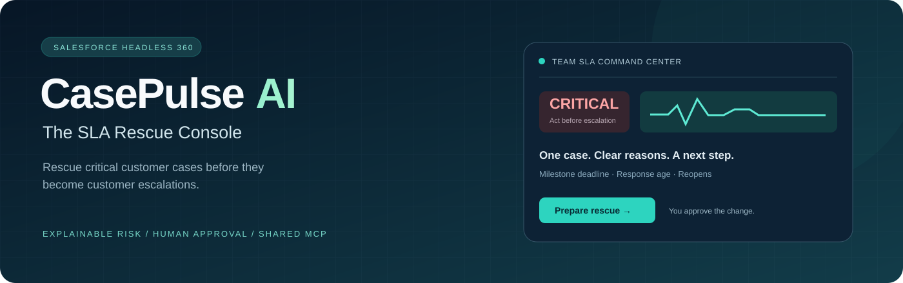
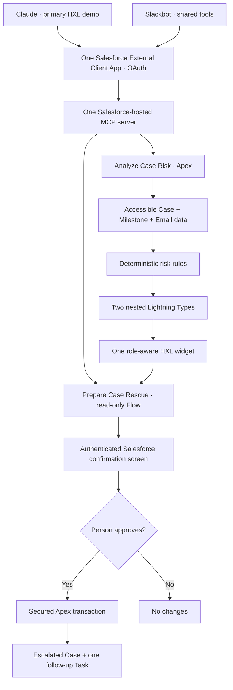
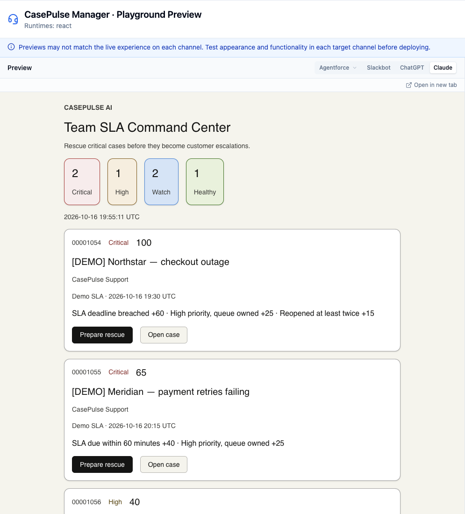
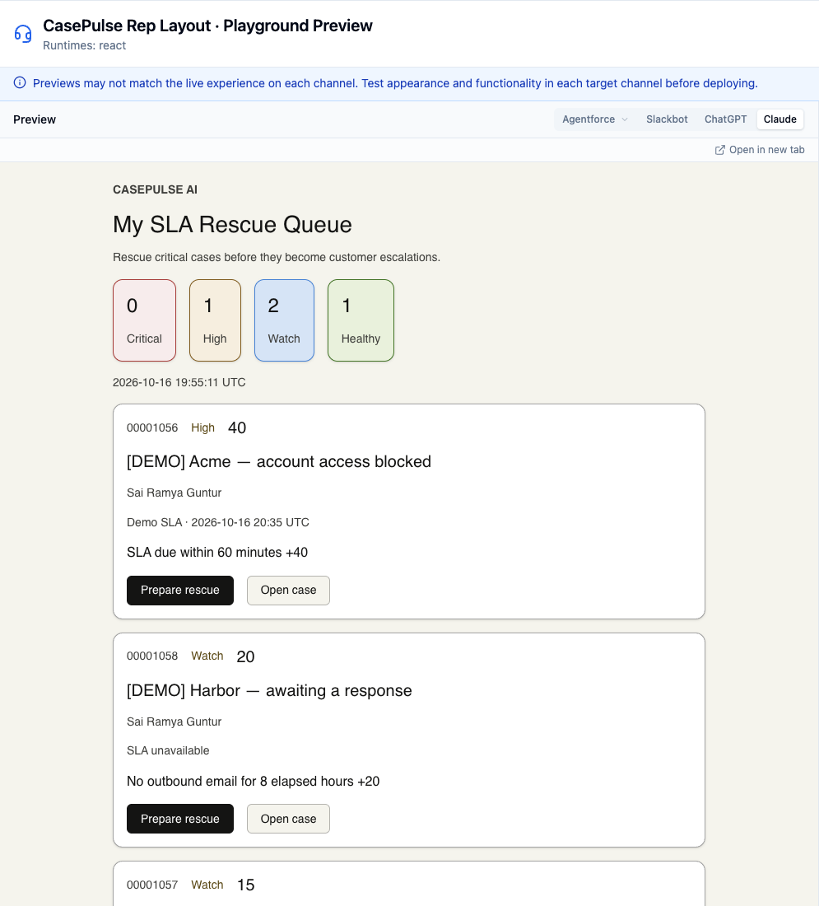
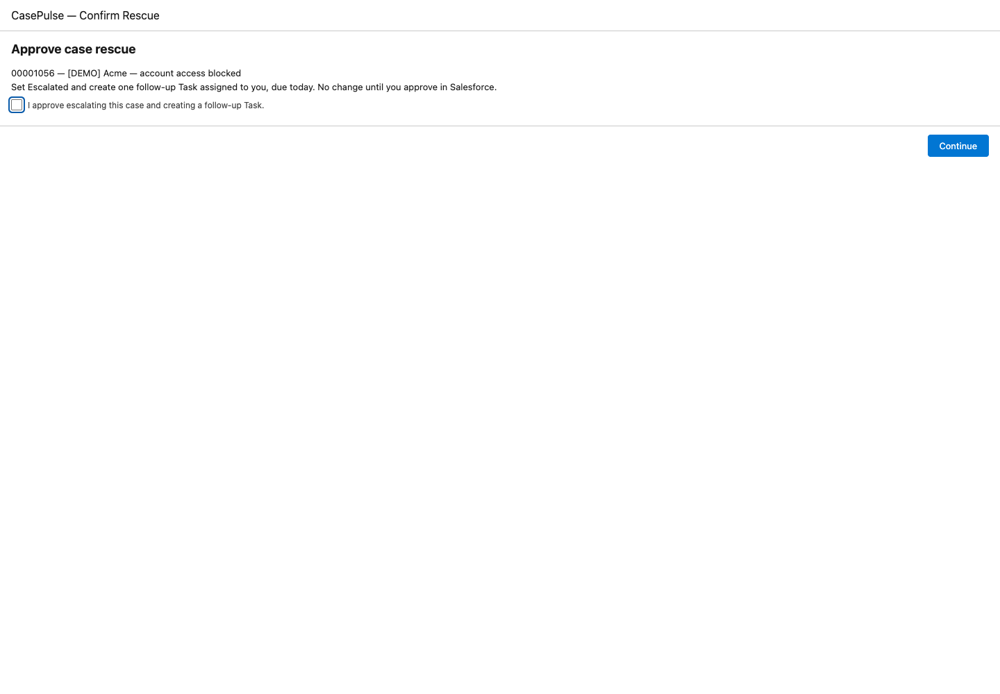
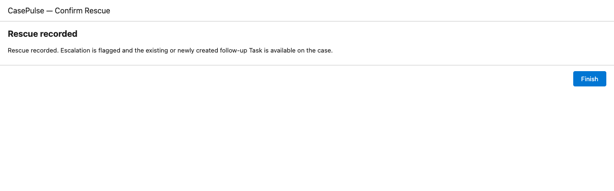

<div align="center">



**Rescue critical customer cases before they become customer escalations.**

Salesforce Headless 360 · Service Cloud · Hosted MCP · HXL · Apex · Salesforce Flow

**10 Apex tests passing · 93.7% project coverage · deployed to a development org**

[Get started](steps.md) · [Verification evidence](docs/verification.md) · [Architecture](#how-it-works) · [Demo](#a-two-minute-rescue)

</div>

## From a hundred open cases to a clear next step

A support manager should not need five reports to find the customer who needs help now. CasePulse turns a natural-language request—**“Show me cases that need immediate attention”**—into a ranked, explainable rescue queue.

The assistant chooses the tool and explains the result. **Apex determines the risk. Salesforce enforces access. A person approves the rescue.**

| My SLA Rescue Queue                             | Team SLA Command Center                                            |
| ----------------------------------------------- | ------------------------------------------------------------------ |
| Rep view: cases owned by the authenticated user | Manager view: configured support queue and its direct user members |
| Personal priorities, deadlines, and next steps  | Team risk totals and intervention opportunities                    |
| Rescue your own accessible open cases           | Requires a custom permission and Salesforce record access          |

## Built once, exposed through one MCP server

- **Explainable risk scoring:** deterministic rules, visible reasons, and timestamped evidence.
- **Service Cloud context:** Case, optional CaseMilestone, outgoing EmailMessage, and reopen history.
- **Headless Experience Layer:** one declarative `UiWidgetBundle` with a typed MCP response and native client rendering.
- **Human-in-the-loop automation:** read-only rescue preparation → Salesforce confirmation → escalation flag and follow-up Task.
- **Role-aware authorization:** authenticated identity, explicit manager permission, sharing, CRUD, and field-level security.
- **Duplicate prevention:** a locked Case record and protected Task marker keep repeated approvals from creating extra work.
- **No external model API key required by this project:** Claude or Slackbot supplies conversational orchestration; Salesforce hosts the tools.

## How it works



| MCP tool            | Backing implementation                       | Effect                                                            |
| ------------------- | -------------------------------------------- | ----------------------------------------------------------------- |
| `analyzeCaseRisk`   | `CaseRiskAnalyzer` invocable Apex            | Read-only analysis; `view=MY` or `TEAM`; optional `demoOnly=true` |
| `prepareCaseRescue` | `CasePulse_Prepare_Rescue` autolaunched Flow | Validates `caseId` and returns an approval link; no writes        |

The internal `CaseRescueApply` action is **not exposed as an MCP tool**. The Screen Flow defaults approval to false and revalidates the case before writing. The conversational client cannot perform a rescue through either published tool.

## Risk you can explain

| Signal                                    | Points |
| ----------------------------------------- | -----: |
| Incomplete milestone deadline breached    |     60 |
| Deadline within the next 60 minutes       |     40 |
| High-priority case still owned by a queue |     25 |
| No outbound email for eight elapsed hours |     20 |
| Reopened at least twice                   |     15 |

Only one deadline signal applies. Scores cap at **100**: Critical ≥60, High ≥30, Watch >0, Healthy =0.

A real incomplete CaseMilestone takes precedence. When unavailable, a custom deadline is explicitly labeled **Demo SLA**; no deadline means **SLA unavailable**. Response age uses the latest outgoing EmailMessage, falling back to case creation. Seeded reopen history is synthetic; subsequent closed-to-open transitions are counted automatically.

These are portfolio triage heuristics, not predictive ML or a replacement for contractual business-hours milestone calculations. High means the literal Salesforce priority value `High`; other priority taxonomies need configuration before production use.

## Run it

Use **Node 22.19+** and a Salesforce development org with HXL beta enabled. Run `nvm install` first if your installed Node 22 is older.

```sh
nvm use
npm ci
npx sf project deploy start --manifest manifest/core.xml --target-org YOUR_ORG --test-level RunSpecifiedTests --tests CasePulseTests --wait 10
npx sf project deploy start --manifest manifest/experience.xml --target-org YOUR_ORG --wait 10
npx sf project deploy start --manifest manifest/auth.xml --target-org YOUR_ORG --wait 10
```

Follow [steps.md](steps.md) to assign permission sets, seed fictional cases, configure OAuth, activate the server, connect clients, and capture evidence. `manifest/auth.xml` deploys the app registration; the OAuth staging helper prepares its plugin settings outside tracked source. Never retrieve OAuth secrets into Git.

## A two-minute rescue

1. Ask: **“Use analyzeCaseRisk with view TEAM and demoOnly true. Show cases that need immediate attention.”**
2. Inspect the top case’s deadline source, score, and individual risk reasons.
3. Ask for `view MY` to show the personal queue. Use a separate rep identity to demonstrate permission enforcement.
4. Select **Prepare rescue**, open the returned Salesforce link, review the case, and explicitly approve.
5. Verify the escalation flag and one Task, assigned to the approving user and due today. Repeating approval creates no duplicate Task.

## Visuals



<details>
<summary>Rep layout and Salesforce approval</summary>







</details>

**Live Claude verified by the owner:** the tool returns the correct fictional cases and the interactive HXL console appears in a fresh conversation. The screenshots below remain explicitly labeled Playground previews.

Screenshots and their provenance are listed in [docs/screenshots/README.md](docs/screenshots/README.md). Playground renders are labeled as previews; they are not presented as proof of a Claude or Slack connection.

## Validation and practical limits

See [verification.md](docs/verification.md) for actual deployment IDs, Apex results, coverage, UI checks, and pending client setup.

- Up to **500 accessible open cases** are evaluated, oldest first; the top **20** are returned, ranked by score, earliest deadline, then case number. Counts explicitly distinguish all scoped cases from evaluated cases.
- Permission failures stop the operation rather than silently substituting incomplete SLA data.
- Team scope includes one queue and direct user members, not nested groups or automatic role-hierarchy expansion.
- A rescue creates one Task per case for this MVP. Deleting that Task does not reset the marker or create a new rescue cycle.
- HXL uses each client’s native theme; visual styling can differ across surfaces.
- Salesforce currently documents that HXL does not render through Slackbot’s Block Kit path. Slack shares the tools and Salesforce approval link; identical visuals are not promised. [HXL channel guide](https://developer.salesforce.com/docs/platform/hxl/guide/hxl-mcp-channels.html)
- Claude Free currently supports one custom remote MCP connector. Slackbot availability depends on the workspace; a developer sandbox is the recommended development route. [Claude connector guide](https://support.claude.com/en/articles/11175166-get-started-with-custom-connectors-using-remote-mcp) · [Slack workshop](https://slack.dev/workshops/bringing-salesforce-flow-logic-into-slack-with-a-custom-mcp-server/)

## Project map

```text
force-app/main/default/   Apex, Case fields, permissions, queue, Flows,
                         HXL widget, Lightning Types, MCP server, app registration
manifest/                Separate core, experience, and auth deployments
scripts/apex/            Fictional demo data and developer snapshot helpers
scripts/python/          Metadata checks and isolated deployment staging
scripts/                 Browser verification and screenshot capture
steps.md                 Numbered setup and demo runbook
docs/                    Verification evidence, fixtures, and screenshots
```

**Portfolio focus:** practical Service Cloud engineering, governed agent actions, interoperable MCP tools, explainable decision support, and customer experience improvement. No unsupported claims about production readiness, breach prediction, or measured business outcomes.
